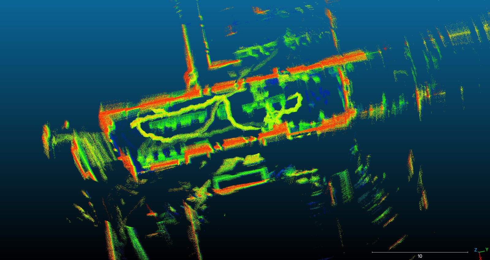
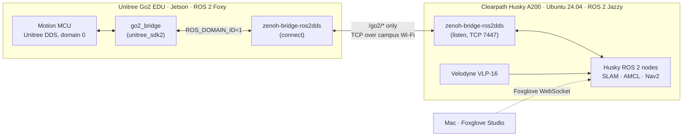
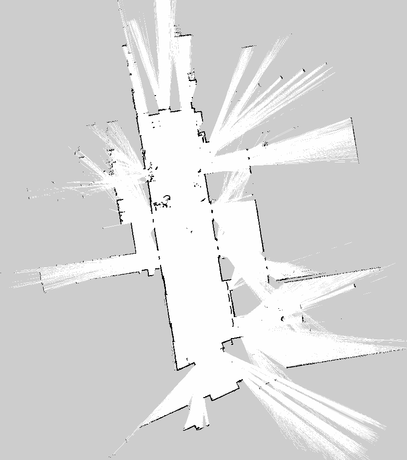
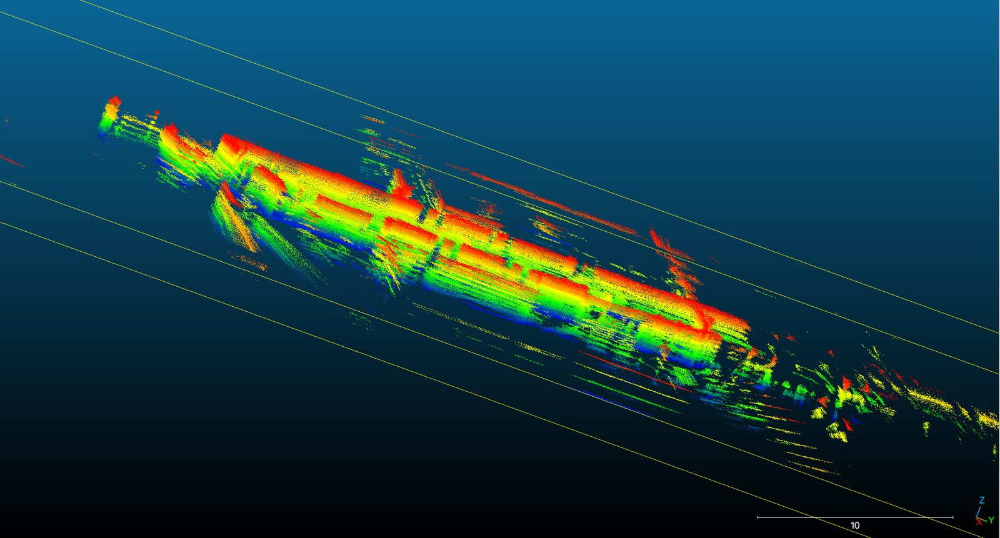

# Husky A200 on ROS 2 Jazzy: LiDAR Mapping, Nav2 and a Unitree Go2 Bridge

**English** | [中文](README.zh-CN.md)


Bring-up, mapping and multi-robot communication for a **Clearpath Husky A200** (serial `a200-0544`) at Penn State.
The robot was moved from ROS Kinetic to **Ubuntu 24.04 + ROS 2 Jazzy**. This repository holds the configuration, operating procedures, a recorded LiDAR dataset with a 3D map, and `go2_bridge`, a ROS 2 package that connects the Husky to a **Unitree Go2** over campus Wi‑Fi.

<p align="center">
  
  <br><sub>3D point-cloud map built offline from the <code>husky_1008</code> recording (KISS-ICP + <code>build_map.py</code>). The bright yellow band is the robot's path.</sub>
</p>

## Highlights

| Area | What was done |
|---|---|
| **Jazzy bring-up** | Fresh install from Clearpath's docs: `robot.yaml`-driven sensors, a netplan bridge for the wired network, Foxglove visualization and joystick/keyboard teleop |
| **2D SLAM → Nav2** | Map built with `slam_toolbox`, then AMCL localization and goal navigation with Nav2 on the saved map |
| **3D LiDAR map** | Offline KISS-ICP on a 7-minute VLP-16 recording: **59.5 m path, 0.13 m end-point drift (≈0.2 %)**, 1.89 M-point map |
| **Measured extrinsics** | LiDAR pose relative to `base_link` measured on the robot and written back into `robot.yaml` (`xyz = [-0.28, 0, 0.748]` m) |
| **Husky ↔ Go2 bridge** | `unitree_sdk2` → ROS 2 node on the Go2's Jetson, linked to the Husky with `zenoh-bridge-ros2dds` over TCP. This works even though campus Wi‑Fi blocks multicast and the robots run different ROS 2 distros (Foxy ↔ Jazzy) |

## Repository layout

```
HuskyA200/
├── README.md / README.zh-CN.md     Overview (EN) / full operating runbook (中文)
├── DATA_MANIFEST.md (+ .zh-CN)     Data inventory for the reconstruction & digital-twin teams
├── config/                         Robot-side network config backup
├── samples/husky_1008/             LiDAR dataset: 2D map, 3D map, KISS-ICP poses, robot.yaml, build_map.py
├── go2_bridge/                     ROS 2 package that runs on the Go2's Jetson (C++, unitree_sdk2)
├── go2_tools/go2_state_test/       SDK-only state reader, no ROS (skipped by colcon)
└── docs/                           Husky ↔ Go2 communication notes (summary + detailed log)
```

## System overview



## Quick start

### 1. Operate the Husky

Connect to the robot's Wi‑Fi router, then SSH in and source the environment:

```bash
ssh admin@<husky-ip>
source /opt/ros/jazzy/setup.bash
source /etc/clearpath/setup.bash
ros2 topic hz /a200_0544/sensors/lidar3d_0/points   # expect ~10 Hz
```

Drive with the Logitech F710 (hold **LB**, then use the left stick), or from the keyboard:

```bash
ros2 run teleop_twist_keyboard teleop_twist_keyboard \
  --ros-args -p stamped:=true -r cmd_vel:=/a200_0544/cmd_vel
```

> Jazzy uses `geometry_msgs/TwistStamped` for velocity commands, and all topics, including TF, live under the `/a200_0544` namespace.

The full step-by-step runbook (power-on, Foxglove, SLAM, Nav2, recording, troubleshooting) is in [**README.zh-CN.md**](README.zh-CN.md).

### 2. Map → localize → navigate

```bash
# Build a 2D map (drive slowly, close the loop at the start point)
ros2 launch clearpath_nav2_demos slam.launch.py setup_path:=/etc/clearpath/ \
  scan_topic:=/a200_0544/sensors/lidar3d_0/scan
ros2 run nav2_map_server map_saver_cli -f ~/maps/lab_map --ros-args -r map:=/a200_0544/map

# Localize on the saved map, then start Nav2
ros2 launch clearpath_nav2_demos localization.launch.py setup_path:=/etc/clearpath/ \
  map:=/home/admin/maps/lab_map.yaml scan_topic:=/a200_0544/sensors/lidar3d_0/scan
ros2 launch clearpath_nav2_demos nav2.launch.py setup_path:=/etc/clearpath/ \
  scan_topic:=/a200_0544/sensors/lidar3d_0/scan
```

In Foxglove, publish the initial pose on `/a200_0544/initialpose` and goals on `/a200_0544/goal_pose`.

### 3. Rebuild the 3D map from a recording (no ROS needed)

```bash
pip install "kiss-icp[all]" rosbags numpy
kiss_icp_pipeline --config samples/husky_1008/kiss.yaml \
  --topic /a200_0544/sensors/lidar3d_0/points <bag_dir>
python samples/husky_1008/build_map.py <bag_dir> results/latest/<name>_poses.npy
```

The raw bag (2.5 GB) is not in Git. See [`samples/husky_1008/README.md`](samples/husky_1008/README.md) for where it lives, what each topic contains, and a workaround for `rosbags` and metadata v9.

### 4. Husky ↔ Go2 bridge

Build `go2_bridge` on the Go2's Jetson (ROS 2 Foxy, `unitree_sdk2` installed to `/opt/unitree_robotics`):

```bash
cd ~/go2_ws/src && git clone https://github.com/greenaandblue/HuskyA200.git
cd ~/go2_ws && source /opt/ros/foxy/setup.bash
colcon build --packages-select go2_bridge
```

Run it on a ROS domain other than 0, because domain 0 carries the dog's own DDS traffic:

```bash
export ROS_DOMAIN_ID=1 RMW_IMPLEMENTATION=rmw_fastrtps_cpp
ros2 run go2_bridge go2_bridge --ros-args -r __ns:=/go2 -p network_interface:=eth0
```

| Interface | Type | Description |
|---|---|---|
| `/go2/odom` | `nav_msgs/Odometry` (out, 50 Hz) | Pose and body-frame twist from `rt/sportmodestate` |
| `/go2/cmd_vel` | `geometry_msgs/Twist` (in) | `SportClient::Move()`, clamped by `max_vx/max_vy/max_wz`; stops after `cmd_timeout` (0.5 s) without input |
| `/go2/command` | `std_msgs/String` (in) | `stand_up`, `stand_down`, `recovery_stand`, `stop` |

Starting the zenoh bridges, the full 4-terminal procedure, and every issue hit along the way (CycloneDDS header clash, `bad_alloc` storm on domain 0, services not crossing zenoh) are covered in [`docs/2026-10-12_husky_go2_comm_detailed.md`](docs/2026-10-12_husky_go2_comm_detailed.md).

## Results

<table>
<tr>
<td width="42%"></td>
<td></td>
</tr>
<tr>
<td align="center"><sub>2D occupancy grid (slam_toolbox, 0.05 m/px)</sub></td>
<td align="center"><sub>3D map, side view</sub></td>
</tr>
</table>

| KISS-ICP metric (`husky_1008`) | Value |
|---|---|
| Frames processed | 4109 / 4109 (VLP-16 at ≈9.9 Hz) |
| Path length | 59.5 m |
| End-point drift (loop back to start) | 0.13 m |
| Map size | 1,893,669 points at 0.05 m voxels |
| Offline speed | ≈277 Hz on a MacBook Air |

## Status and roadmap

- [x] Ubuntu 24.04 + ROS 2 Jazzy bring-up, networking, teleop
- [x] 2D SLAM, AMCL localization and Nav2 goal navigation
- [x] Measured LiDAR extrinsics; first LiDAR dataset with 3D map
- [x] Go2 → Husky odometry and Husky → Go2 `cmd_vel` over Wi‑Fi
- [ ] Field-test `/go2/command` (stand up / walk / stand down) on the real dog
- [ ] Launch scripts to replace the 4-terminal manual startup
- [ ] Align the 3D map and KISS-ICP poses with the `map` frame and the building model
- [ ] Add the UM7 IMU and NovAtel GPS to `robot.yaml`

## Documentation

| Document | Contents |
|---|---|
| [README.zh-CN.md](README.zh-CN.md) | Operating runbook (Chinese): connection, teleop, SLAM, Nav2, recording, troubleshooting |
| [DATA_MANIFEST.md](DATA_MANIFEST.md) | Inventory of collected data, formats, frames and verification status |
| [samples/husky_1008/README.md](samples/husky_1008/README.md) | Dataset card for the 2026-10-08 LiDAR recording |
| [docs/…_comm_summary.md](docs/2026-10-12_husky_go2_comm_summary.md) | One-page Husky ↔ Go2 progress summary (EN + 中文) |
| [docs/…_comm_detailed.md](docs/2026-10-12_husky_go2_comm_detailed.md) | Full setup log, procedures and root-cause notes |

## Maintainer

**Huihang Liu** · Computer Engineering, Penn State · [@greenaandblue](https://github.com/greenaandblue)
