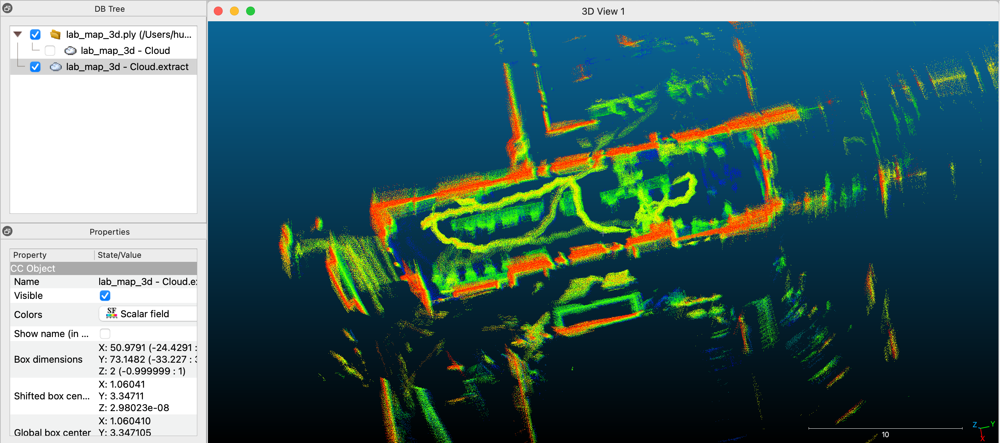
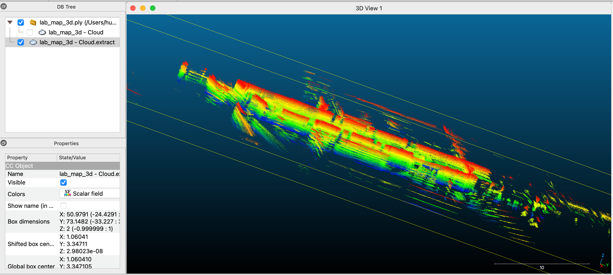

# Sample: husky_1008

[中文](README.zh-CN.md) | **English**

## Summary

LiDAR sample collected in ____ (room number) by a Clearpath Husky A200 with a Velodyne VLP-16. Includes raw point clouds, TF, odometry, AMCL poses in the map, a 2D occupancy map, and a 3D point-cloud map built with KISS-ICP. **LiDAR extrinsics are tape-measured (≈ ±1 cm); KISS-ICP loop-closure error is 0.13 m.**




## Collection info

| Item | Value |
|---|---|
| Date / time | 2026-10-08 14:52–14:59 EDT (18:52–18:59 UTC) |
| Location | ____ (room / exhibit area) |
| Robot | Clearpath Husky A200, serial a200-0544, ROS namespace `a200_0544` |
| System | Ubuntu 24.04 Server + ROS 2 Jazzy |
| LiDAR | Velodyne VLP-16, IP 192.168.131.20, ≈10 Hz |
| LiDAR extrinsics (`base_link` → `lidar3d_0_link`) | xyz = [-0.28, 0.0, 0.748] m, rpy = [0, 0, 0]; tape-measured, ≈ ±1 cm |
| Motion | Teleoperated with a Logitech F710; one loop around the room, ending at the start; average speed ≈0.37 m/s |
| Duration | 414 s total; ≈160 s of driving (roughly 145–305 s), stationary at both ends |
| Collected by | Huihang Liu |

### How the extrinsics were measured

- `base_link` is at the midpoint between the front and rear axles, ≈0.132 m above the floor (wheel radius 0.165 m minus the axle height above `base_link`, 0.033 m, taken from TF).
- The bottom of the LiDAR is 0.88 m above the floor, so z = 0.88 − 0.132 = 0.748 m (`lidar3d_0_link` is the bottom of the sensor; the laser center `lidar3d_0_laser` is ≈3.77 cm above it).
- The LiDAR sits on the robot's centerline (y = 0), 0.28 m behind the body center (x = −0.28).

## Recording command

```bash
ros2 bag record -o ~/bags/husky_1008 \
  /a200_0544/sensors/lidar3d_0/points \
  /a200_0544/tf /a200_0544/tf_static \
  /a200_0544/platform/odom/filtered \
  /a200_0544/amcl_pose
```

## Folder layout

```
husky_1008/
├── map/
│   ├── lab_map.pgm       # 2D occupancy map (slam_toolbox, 2026-09-29)
│   └── lab_map.yaml
├── poses/                # KISS-ICP poses
├── lab_map_3d.ply        # 3D point-cloud map
├── map_3d_top.png        # screenshots
├── map_3d_view.png
├── robot.yaml            # /etc/clearpath/robot.yaml at recording time
├── build_map.py          # script that builds the .ply from bag + poses
├── kiss.yaml             # KISS-ICP config
├── README.md
└── README.zh-CN.md
```

**The raw bag (2.5 GB) is not in this repository.** Download `husky_data/husky_1008_bag.zip` from [Penn State OneDrive](https://pennstateoffice365-my.sharepoint.com/:f:/g/personal/hql5777_psu_edu/IgA_7Cs5Jh-zTJNAbwq7xDVJAbg5i8gbh1v7fchn9oirfLY?e=bYKxtB) (Penn State accounts only). The same folder also has `husky_data/map_3d_video.mov`, a fly-through video of the 3D map.

## Bag contents

| Topic | Message type | Count | Rate | Frame | Status |
|---|---|---|---|---|---|
| `/a200_0544/sensors/lidar3d_0/points` | `sensor_msgs/PointCloud2` | 4109 | ≈9.9 Hz | `lidar3d_0_laser` | ✅ |
| `/a200_0544/tf` | `tf2_msgs/TFMessage` | 25457 | — | — | ✅ |
| `/a200_0544/tf_static` | `tf2_msgs/TFMessage` | 1 | — | includes LiDAR extrinsics | ✅ |
| `/a200_0544/platform/odom/filtered` | `nav_msgs/Odometry` | 18119 | ≈44 Hz | `odom` → `base_link` | ⚠️ Unverified |
| `/a200_0544/amcl_pose` | `geometry_msgs/PoseWithCovarianceStamped` | 199 | low | `map` | ⚠️ Unverified |

- Format: ROS 2 bag (mcap), rosbag2 metadata version 9, ROS 2 Jazzy.
- Inspect with `ros2 bag info <bag folder>`. To read it on macOS / Windows without ROS: `pip install rosbags`.
- Note: `rosbags` 0.9.x does not support metadata version 9. Either upgrade to 0.10+, or do what we did: make a separate folder containing a copy of `metadata.yaml` changed to version 8 (QoS fields emptied) plus a symlink to the original `.mcap`. **The original bag is unchanged.**

## Derived data

| File | How it was made | Frame | Notes |
|---|---|---|---|
| `map/lab_map.*` | slam_toolbox (2026-09-29) | `map` | Resolution 0.05 m; origin [-20.246, -26.585, 0] |
| `poses/*_poses.npy` | KISS-ICP (`deskew: true`, `min_range: 1.0`, `max_range: 50.0`) | first LiDAR frame | 4109 × 4 × 4 homogeneous transforms, one per point-cloud frame in the bag |
| `lab_map_3d.ply` | KISS-ICP poses + `build_map.py` (0.05 m voxels) | first LiDAR frame | 1,893,669 points, 22 MB |

### KISS-ICP results

| Metric | Value |
|---|---|
| Frames processed | 4109 / 4109 |
| Path length | 59.5 m |
| Loop-closure error (end vs. start) | 0.13 m (≈0.2%) |
| Processing speed | ≈277 Hz (MacBook Air) |

## Caveats

- The 3D map and KISS-ICP poses are in the **first LiDAR frame**, **not** the `map` frame. The two are not aligned yet.
- Points within 1 m of the LiDAR (mostly the robot body) were removed.
- KISS-ICP has no loop closure; this route returned to the start with 0.13 m error.
- The robot was stationary at the start and end of the recording; people walking nearby may leave a few points from moving objects.
- Known issues: none so far.

## Still missing

- [ ] Align the 3D map / KISS-ICP poses with `map` and the building model
- [ ] Independent check of pose accuracy
- [ ] Reconstruction team to confirm: can the bag be used directly, and what format do you need for poses and calibration?
