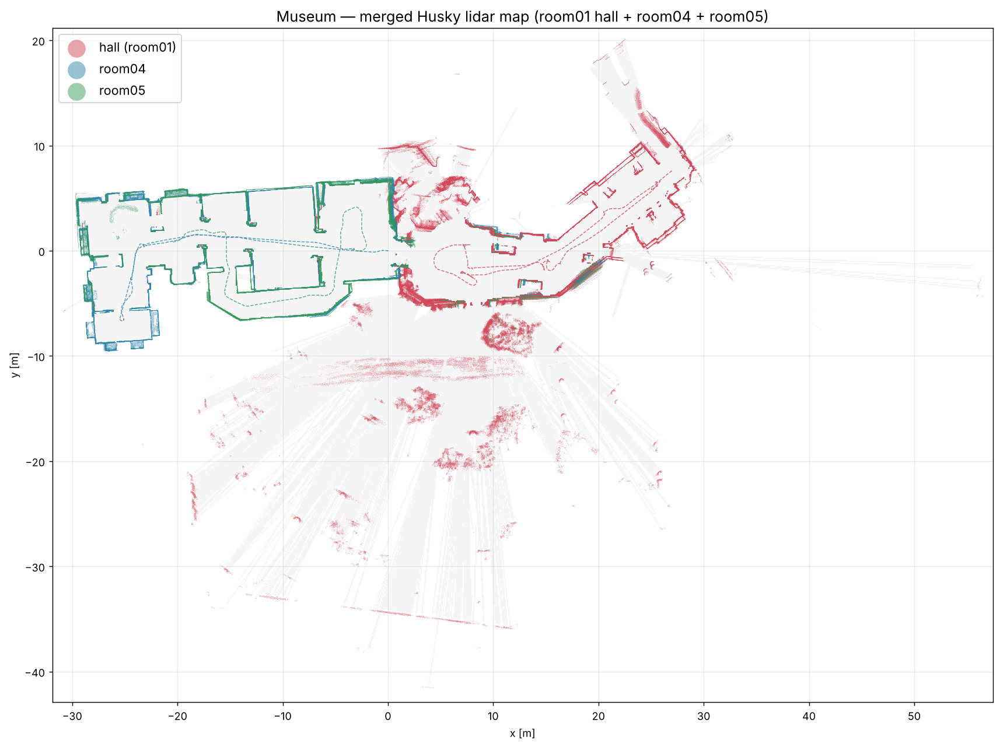

# Sample: museum_1019

[中文](README.zh-CN.md) | **English**

## Summary

Husky A200 + Velodyne VLP-16 field capture in a museum on 2026-10-19: the entrance hall (`room01`) and the inner rooms, driven twice (`room04`, `room05`). The three recordings are merged into **one point-cloud map in a common frame**, with a Nav2 occupancy map and two 3D models (a clean architectural model and a scan mesh). **Alignment error 7 cm RMS (room04 ↔ room05) and 9 cm RMS (hall ↔ rooms); floors agree within 2 cm.** Outdoor points seen through glass and below-floor reflections are removed.



## Collection info

| Item | Value |
|---|---|
| Date / time | 2026-10-19, 09:58–10:43 EDT (13:58–14:43 UTC) |
| Location | ____ (museum name), entrance hall + inner rooms |
| Robot | Clearpath Husky A200, serial a200-0544, ROS namespace `a200_0544`, Ubuntu 24.04 + ROS 2 Jazzy |
| LiDAR | Velodyne VLP-16, 10 Hz, extrinsics xyz = [-0.28, 0, 0.748] m, rpy = 0 (as in `husky_1008`) |
| Network | none at the museum; robot clock NTP-synced before leaving |
| Collected by | Huihang Liu (Husky). The Go2 was run separately by Yifei; its data is not in this sample |

| Recording | Area | Time (EDT) | Duration | Path | Avg speed | Scans | Bag |
|---|---|---|---|---|---|---|---|
| `room01` | Hall | 09:58:18–10:05:31 | 433 s | 79.2 m | 0.18 m/s | 4148 | 2.5 GiB |
| `room04` | Inner rooms, pass 1 | 10:33:33–10:37:15 | 222 s | 62.8 m | 0.28 m/s | 2052 | 1.2 GiB |
| `room05` | Inner rooms, pass 2 | 10:40:56–10:42:55 | 120 s | 37.7 m | 0.32 m/s | 1170 | 0.7 GiB |

Two other recordings are not included: `room02` was started by accident, and `room03` was lost when the robot ran out of battery mid-recording, before the bag was saved. Path lengths and speeds come from the LiDAR odometry.

## Recording command

```bash
ros2 bag record -o ~/dt_capture/Husky/<name>/bag \
  /a200_0544/sensors/lidar3d_0/points \
  /a200_0544/tf /a200_0544/tf_static \
  /a200_0544/platform/odom/filtered
```

Recorder reported 164 / 164 / 21 messages lost on the transport layer (0.35 % / 0.69 % / 0.16 %). See `recording_info/` for `ros2 bag info` output and metadata of each recording.

## Folder layout

```
museum_1019/
├── museum_merged_clean.ply     # merged cloud, indoor only, 5 cm, 1.52 M points; fields x y z intensity room (0 hall, 1 room04, 2 room05)
├── clouds/room0{1,4,5}_aligned.ply   # per-recording clouds in the museum frame, 4 cm
├── poses/                      # per-scan LiDAR poses in the museum frame (.npy N×4×4 and TUM .txt)
├── transforms.json             # 4×4 transform: each recording's KISS-ICP frame -> museum frame
├── map/museum_map.pgm + .yaml  # Nav2 occupancy map, 0.05 m
├── model/
│   ├── museum_architectural.glb / .stl   # floor, walls to ceiling height, lintels, exhibits as blocks, glass door
│   ├── museum_scan_model.glb             # Poisson scan mesh, 1.12 M triangles, flat floor, glass door
│   ├── museum_scan_model.stl             # same, decimated to 0.56 M triangles
│   ├── museum_scan_model_web.glb         # 0.32 M triangles
│   └── door.json                         # measured hall <-> room04 double door
├── viewers/                    # offline HTML viewers (open in any browser, no internet needed)
├── images/                     # floor plan, indoor/outdoor cleanup preview
├── recording_info/             # bag_info / metadata / topics for each recording
├── robot.yaml
└── scripts/                    # processing pipeline (see below)
```

**Raw bags (4.4 GiB) are not in this repository**; they go to the OneDrive `husky_data` folder like the other samples.

## Frame

`museum` frame: z = 0 on the floor, walls axis-aligned, origin = the LiDAR start position of `room04` (at the hall ↔ room04 doorway), metres. `transforms.json` maps each recording's KISS-ICP frame (LiDAR pose at its first scan) into it. Poses in `poses/` are already in this frame. The STL files are in **metres** (choose metres when importing into CAD).

## Processing

| Step | Method | Compute (2 vCPU) |
|---|---|---|
| LiDAR odometry | KISS-ICP, voxel 0.2 m, range 1–40 m, poses constrained to SE(2) (flat floor) | 14 min |
| room05 → room04 | exhaustive 2D correlative search over wall occupancy, then planar point-to-plane ICP | < 1 min |
| hall → rooms | same search + free-space consistency (walls may not fall where the other map saw open air), then ICP; joined through the open glass double door | 1.5 min |
| Merge / clean | remove people walking with the robot (cells mostly seen through), indoor/outdoor flood-fill from the robot paths + two indoor areas confirmed on site | 2 min |
| 3D models | Poisson depth 10 on one-recording-per-voxel points, Taubin smoothing, flat floor from LiDAR free space; architectural walls extruded to measured ceiling height; door modelled from measurements | 3 min |

`scripts/` contains the code as it was run (paths point to the processing machine and need editing): `map_room.py` (odometry), `register.py`, `freespace.py`, `run_fs.py` (alignment), `build_final.py` (merge, Nav2 map), `interior.py` (indoor mask), `prep_mesh_cloud.py`, `poisson.py`, `floor.py`, `build_model.py` (scan mesh), `arch_model.py`, `export_arch.py`, `door_model.py` (architectural model, door).

## Results

| Check | Value |
|---|---|
| room04 ↔ room05 | 73 % of wall points within 15 cm, 7 cm RMS |
| hall ↔ rooms | 9 cm RMS |
| Floor height across recordings | within 2 cm |
| Wall noise, single recording | 3.2 cm RMS |
| Ceiling height | 2.6–3.4 m |
| Modelled area | ≈ 660 m² footprint, 556 m² floor |
| Hall ↔ room04 door | opening 2.25 × 2.13 m, two 1.12 m leaves, wall ≈ 0.9 m deep, scanned open ~90° toward the hall |

## Caveats

- Wheel odometry is **not** usable to link recordings: its heading drifted ≈ 38° between `room04` and `room05` within one robot boot.
- Per-recording drift leaves 5–10 cm wall offsets between `room04` and `room05` in places.
- The area north of the hall (near the glass door) is barely covered; geometry there is rough.
- Glass (doors, windows) is not in the scan; it appears as openings. Only the hall ↔ room04 door is modelled.
- VLP-16 sees the floor only within ≈ 3.4 m of the robot; the model floor is filled from LiDAR free space.

## Still missing

- [ ] Upload the raw bags to OneDrive
- [ ] Align the museum frame with the building model
- [ ] Go2 data from the same visit (Yifei)
